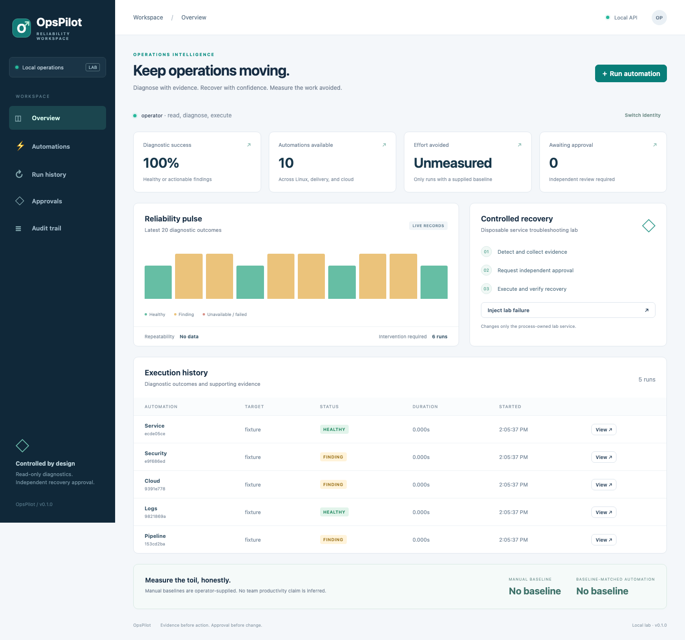

# OpsPilot

[](https://github.com/jayekwere/opspilot/actions/workflows/verify.yml)

**Evidence before action. Approval before change.**

OpsPilot is a working local IT operations automation platform with a Python diagnostic engine, authenticated FastAPI API and CLI, and a React and TypeScript operations console. Ten runbooks turn collected evidence into supported findings and next actions. Independent approval gates verified recovery in disposable service and security labs.



## What it does

- Diagnose CPU and memory pressure, disk capacity and inodes, failed services, DNS and TCP connectivity, TLS trust and expiry, Kubernetes conditions, GitHub Actions failures, log errors, EC2 posture, and SSH configuration.
- Record per-run inputs, evidence, findings, duration, intervention needs, and audit events in private SQLite state.
- Require separate diagnostic, approval, and execution permissions. Approval binds to the finding and lab generation and expires after ten minutes.
- Recover a disposable HTTP service or repair an inert temporary SSH configuration, then recollect evidence to verify the result.
- Report diagnostic success and failure rates, repeatability, and estimated effort avoided only when an explicit manual baseline is supplied.

This is a local engineering reference implementation. Production host remediation, fleet execution, multi-tenant access, and measured human productivity improvements are outside its validated scope. Fixture inputs are labeled throughout the API and UI.

## Run locally

Requirements: Python 3.14, Node 24 or later, and a POSIX host. Linux is required for `/proc`, systemd, and journal collectors. Docker provides a reproducible Linux test environment on macOS.

```sh
make install
make build
export OPSPILOT_IDENTITIES="$(.venv/bin/python -m opspilot.cli credentials)"
make serve
```

Open [the local console](http://127.0.0.1:8080). The generated identity map contains two separate random credentials: an operator with read, diagnose, and execute permissions, and an approver with read and approve permissions. Inspect the map locally and enter the relevant token in the console. Keep the map private. Tokens stay in browser memory and disappear on reload or identity switch. The server refuses to start without configured identities.

For CLI diagnostics, set `OPSPILOT_TOKEN` to the operator credential in the same identity map:

```sh
.venv/bin/python -m opspilot.cli run performance --target fixture --scenario failure
.venv/bin/python -m opspilot.cli run filesystem --target local
```

The API exposes its generated contract at [local API docs](http://127.0.0.1:8080/docs). Protected endpoints require `Authorization: Bearer <credential>`. `POST /api/runs` also requires an `Idempotency-Key` of 8 to 80 safe characters. Committed [JSON schemas](schemas/run-request.json) describe strict request fields; extra fields are rejected.

## Reproduce troubleshooting and recovery

```sh
make demo
make benchmark
```

The demo creates a temporary HTTP service returning 503, diagnoses it, records evidence, denies unapproved execution, obtains a separate approver's decision, repairs the service, verifies 200, and checks idempotent replay. A second scenario changes the lab generation after approval and verifies recovery is refused. All temporary state is removed. See [the recorded demo](docs/demo-result.json).

In the console: inject a lab failure, select the service automation with the lab target, diagnose, request recovery, switch to the approver identity, approve with a reason, switch back to the operator, and execute. The security automation also supports a lab target which repairs only a temporary SSH configuration file and its permissions.

## Ten runbooks

| Runbook | Live collection | Supported findings |
| --- | --- | --- |
| Performance | Linux `/proc/meminfo`, load average, CPU pressure | CPU saturation, low memory, pressure stalls |
| Filesystem | Root filesystem `statvfs` | Capacity, inode exhaustion, read-only mount |
| Service | Fixed `sshd.service` systemd status; disposable HTTP lab | Inactive or unhealthy service |
| Network | Fixed `example.com` DNS and TCP 443 | DNS failure and connectivity failure |
| TLS | Verified TLS to fixed `example.com:443` | Trust or hostname failure, expiry under 30 days |
| Kubernetes | Read-only pods, nodes, deployments via kubectl | Unready pods, unhealthy nodes, unavailable replicas |
| Pipeline | GitHub run conclusions and failed job steps | Failed workflows, timeouts, failed steps; fixture log classification |
| Logs | Bounded error-priority journal entries | Error, fatal, timeout, OOM signatures |
| Cloud | EC2 status, volume encryption, security groups | Impaired instances, unencrypted volumes, unrestricted ingress |
| Security | SSH file directives and shadow metadata | Root login, passwords, excessive permissions |

Every runbook has healthy, supported-failure, and unavailable fixture modes and automated coverage. [Runbook contracts](docs/runbooks.md) document targets, evidence, integration prerequisites, and limitations. Fixed targets deliberately exclude arbitrary host, URL, path, and command inputs.

## Validation

```sh
make check test build demo benchmark
npx playwright install chromium
npm run test:e2e
make container
```

Local evidence includes Python tests with an enforced 85% branch-aware coverage floor, real trusted and untrusted TLS handshakes, browser authentication and approval workflows, responsive screenshots, Linux Docker tests, static analysis, dependency audits, and Kubernetes lab validation. See [the verification report](docs/verification.md) for exact results and scope. Hosted verification status is recorded separately in the verification report. The [workflow](.github/workflows/verify.yml) is configured to repeat checks, collect evidence, and publish a container only after a successful tagged verification run.

## Container lab

```sh
docker compose up --build
```

Set `OPSPILOT_IDENTITIES` first. Compose publishes only loopback, drops capabilities, uses a read-only root filesystem, and caps memory, CPU, processes, and temporary storage. Its state is intentionally ephemeral. The runtime uses a non-root user and digest-pinned base images. Provider command-line tools are optional and are not installed in the minimal image; absent integrations return unavailable. Never mount the host Docker socket.

## Measurement without inflated claims

The [benchmark](docs/benchmark.json) records 20 trials of a scripted three-step manual-procedure comparator and OpsPilot diagnosis against the same injected HTTP 503. It does not measure a human operator. The small scripted comparator is faster than the orchestrated diagnostic path in the recorded lab. No execution speedup or human effort savings are claimed. See [methodology](docs/measurement.md).

Manual baselines can be supplied through the API or console with their source. Estimated effort avoided is `max(0, supplied manual seconds - diagnostic seconds)` for completed diagnoses. These are estimates from declared baselines, not observed team productivity. Approval and recovery durations remain separate from diagnostic timing.

## Design and boundaries

[Architecture and workflow diagrams](docs/architecture.md) explain execution and trust boundaries. [SECURITY.md](SECURITY.md) documents credential handling, independent approval, bounded execution, evidence redaction, transport assumptions, and production gaps. [Release notes](docs/release.md) and [contribution guidance](CONTRIBUTING.md) describe validation and maintenance.

OpsPilot complements Linux Support Kit's host troubleshooting guidance and the GitLab CI diagnostic project's specialized pipeline investigation. Its focus is cross-domain orchestration, persisted evidence, independent change approval, recovery verification, and defensible toil accounting. It does not repackage those projects.

MIT licensed. Built for reproducible operational engineering, with limitations stated alongside evidence.
