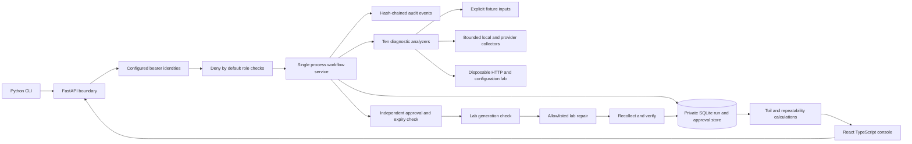
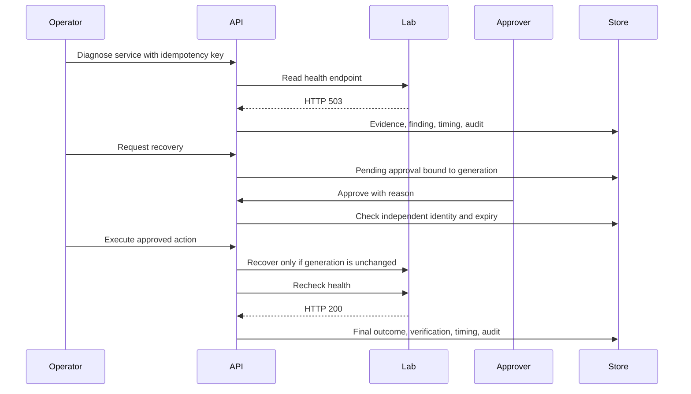

# Architecture and operational workflow

Each diagnosis reserves a durable run before collection. Identical actor and idempotency key return the original record; changing input under the same key returns 409. A crash leaves a reserved run which is marked failed during startup recovery. Startup also invalidates old approvals because the new process owns a fresh lab. Diagnostics report `healthy`, `finding`, `unavailable`, or `failed`. A supported finding is a successful diagnosis, not a healthy system.

The disposable service failure is an intentionally injected HTTP 503, not a claim of reproducing a kernel or hardware fault. Recovery toggles the process-owned service to healthy and confirms HTTP 200. The security lab writes an inert temporary SSH configuration and validates permissions; it never reconfigures the host SSH daemon.

SQLite provides transactional workflow changes. The service supports one process and one worker. It does not implement distributed locks, multi-host remediation, or durable remote workers. These are deliberate scope boundaries, not hidden deployment assumptions.
